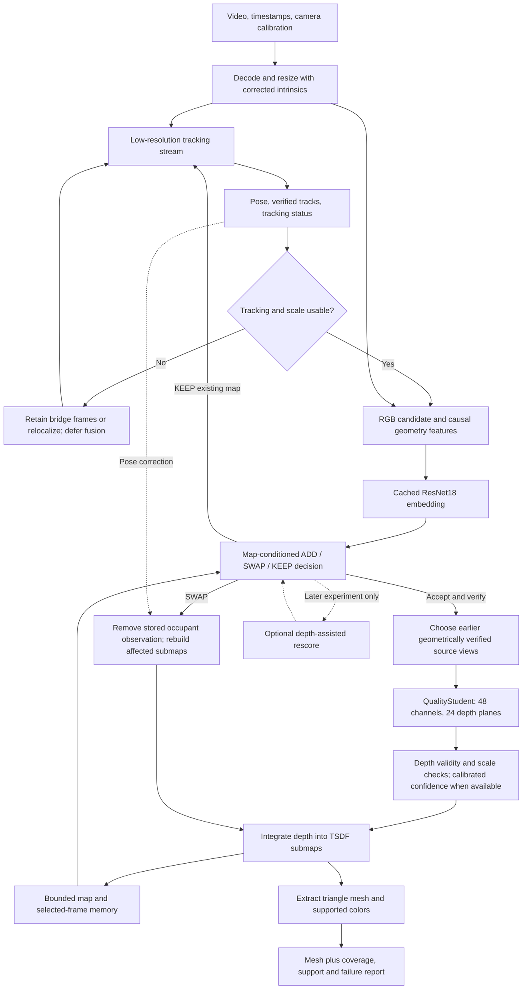
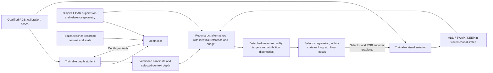

# GeoStreamFusion: architecture for reconstruction-aware frame selection

15 November 2026. This document specifies the next integrated architecture after
reviewing the local code, the remote module inventory, the expanded-training README,
and the recorded cascade diagnosis. It does not certify every remote implementation
or replace the running experiment. **The new action head is implemented and unit
tested; its data adapter, training, and complete video-to-mesh integration remain
to be done. No reconstruction improvement has yet been measured for this head.**

## Design decision

Keep the existing multiview depth student, geometric tracking, and rebuildable TSDF
submaps. Improve the selector's representation of replacements and map coverage,
then test the entire system at equal compute budgets. A larger image network alone
does not resolve incorrect poses, weak reference geometry, stale gain labels, or
replacement decisions that retain poorer frames.

The 14 November diagnosis is the strongest evidence for this choice: 140 harmful
deep overrides rejected beneficial updates, including 123 replacements; the deep
score/gain correlation on routed AMvalley states was −0.163. The inner/refitted-model
protocol and area shift are confounded, so this is evidence of failed transfer,
not proof that one architectural feature caused it. See
[the diagnosis](runs/cascade_failure_diagnosis_20261114/REPORT.md).

## Recommended first version, grounded in completed experiments

Use **one RGB/map-memory selector, the existing versioned multiview student, and
rebuildable TSDF submaps**, with tracking independent of dense frame admission.
The new selector is the next controlled experiment, not an established improvement.
Do not add a learned expert-routing tree or replace the depth backend merely to
increase model size. Keep the simple bin and coverage baselines as promotion controls.

| Completed measurement | What it supports | Architecture decision |
|---|---|---|
| Matched online cheap F **0.382457**, cascade **0.342676**, deep **0.325584** on the same AMvalley evaluation | The tested deeper policy/router failed to transfer its tuning benefit. | Use a single cheap policy first. A deeper branch is a separately evaluated future addition. |
| Cheap requested depth for **526/1,044** frames; cascade **615/1,044** | This cascade increased depth demand while reducing quality. | Charge every accepted/replaced/probed depth and source preparation; optimize total cost, not final frame count. |
| **123** of **140** missed beneficial overrides were SWAPs | Retaining a poorer occupant is a measured failure mechanism. | Compare candidate and occupant against a common map; train and report ADD/SWAP separately. |
| Original learned online F **0.361** versus matched middle-of-bin **0.375** | Learned selection has not consistently beaten the simple bin control. | Evaluate the new head against middle-of-bin, coverage and the matched cheap head; none is assumed universally best. |
| Best-quality AMvalley depth errors: main student **0.037805**, AMtown-only student **0.032504**, larger teacher **0.057306** | Larger teacher capacity did not establish better depth on these matched frames. | Retain the current versioned backend for the first selector ablation. Compare replacements with new fusion evaluation; do not automatically distill this teacher. |
| Teacher Q2 within-clip correlation **0.126926**, main student's **0.201541**, despite teacher pooled correlation **0.568678** | Pooled frame-quality ranking can hide weak ordering within a video. | Train on same-state measured reconstruction gain; do not substitute depth-error confidence or pooled correlation for frame utility. |
| Teacher haze response: Q1 **38.4%**, Q2 **45.3%** rank the corrupted copy worse | Sensitivity to several degradations does not establish haze robustness or mesh improvement. | Include held-out haze/illumination and real motion cases, with depth/reconstruction targets recomputed after corruption. |
| Seven new-head unit tests plus finite CNN/head gradients | Masking, bounded memory, replacement symmetry and gradient flow work mechanically. | Admit the prototype to a training experiment; claim no reconstruction gain from these tests. |

The F-score comparisons above are reference-pose, fixed-context TSDF point-cloud
experiments, not final-mesh scores. The teacher/student depth metric is median
absolute log-depth error and cannot be numerically compared with F-score.
The original online run and the later matched cascade experiment are distinct;
their numbers must not be treated as an isolated architecture ablation.

Sources: [cascade result](runs/online_cascade_20261113/RESULT.md),
[cascade diagnosis](runs/cascade_failure_diagnosis_20261114/REPORT.md),
[original audit](runs/remote_attribution_audit_20261113/REPORT.md),
[teacher/student review](runs/quality_student/RESULTS_REVIEW_20261114.md),
[prototype checks](runs/reconstruction_architecture_20261115/validation.json).

### Concrete configuration to evaluate next

1. **Tracking:** low-resolution chronological tracking, verified covisibility graph,
   calibration/pose checks and protected bridge observations. Dense rejection does
   not remove frames needed for tracking.
2. **Visual encoder:** existing ResNet18/projector, 384-dimensional embedding.
   Initialize identically across head comparisons. Cache only embeddings from a
   fixed encoder version.
3. **Selector:** new 128-wide, two-layer, four-head context network, at most 16
   earlier memory frames, common-map candidate/occupant comparison, separate ADD
   head and zero-gain KEEP alternative. Total encoder plus head: 12,117,065 parameters.
   Use measured student-side ADD/SWAP utility for supervision.
4. **Geometry:** choose two usable earlier source views by verified overlap and
   parallax. Begin with the current versioned depth checkpoint; the proposed
   student family remains 48-channel, 24-plane multiview depth. Changing to a
   QualityStudent checkpoint requires refreshed gains and its own matched comparison.
5. **Surface:** keep the tested submap TSDF backend, observation journal, bounded
   rebuilds for replacement/pose correction and supported triangle-mesh extraction.
6. **Training references:** qualified LiDAR is measured supervision where aligned;
   sparse/map geometry remains explicitly weaker. Use teacher outputs only with
   documented support/alignment and training-side checks. Keep teacher comparisons
   diagnostic until target quality is established on matched contexts.
7. **Optimization:** alternate student updates, fresh measured gains, and selector
   updates. This allows both models to improve across rounds without making the
   selector learn stale rewards. Start without an unvalidated joint mesh-autograd loss.
8. **Acceptance:** matched-budget hard rollouts on development flights, then an
   untouched area and estimated-pose full videos with mesh accuracy/coverage and
   registration failures. A training-loss win alone does not select the architecture.

This is a deliberately testable first configuration. The 16-memory limit and the
new head's width/layer count are proposed engineering choices, not optima discovered
by the completed tests. Ablate memory, comparative scoring and backbone size
separately before attributing any improvement to them.

## Complete intended inference path



This diagram is a target integration, not a claim that these modules already form
one validated runner. The teacher and LiDAR do not appear in inference. With
uncalibrated video, camera initialization/self-calibration and conditioning checks
are required first; monocular geometry remains at arbitrary scale without a metric
anchor. A depth model cannot repair a disconnected camera trajectory.

**Tracking and dense mapping have separate budgets.** Track available low-resolution
frames even when the dense selector rejects them. Preserve verified bridge and
relocalization observations in tracking memory; they need not all receive dense
depth or enter the surface. A moderately blurred unique bridge can be useful even
when a sharper redundant view exists. No universal blur threshold defines utility.

## What already exists and what changes

| Component | Existing code | Next action |
|---|---|---|
| Trainable RGB representation | `large_selector_model.SelectorVisualEncoder`, ResNet18 → 384 dimensions | Reuse initialization and cache retained-frame embeddings; version or invalidate caches after encoder updates. |
| Current expanded-run scorer | `LargeActionSelector(36)`, four Transformer layers, separate ADD/SWAP heads | Preserve as baseline. Its three tokens summarize map state, candidate and occupant. |
| Older graph-aware selector | `graph_selector.MemoryUtilitySelector`, `selector_features.MapState`, `memory_graph.CausalMemory` | Reuse feature/graph infrastructure after an explicit schema adapter; graph memory is already implemented, not a new invention. |
| New pairwise action head | `reconstruction_action_selector.ReconstructionActionSelector` | New isolated prototype with shared replacement scoring and bounded explicit memory. Not wired into the active trainer. |
| Depth student | `depth_student.DepthStudent`, `quality_student.QualityStudent` | Keep 48-channel, 24-plane path as the initial backend; compare quality checkpoints using reconstruction, not only pixel error. |
| Selected-source replay | `selector_improvement.ContextScorer`, context-versioned depth provider | Reuse for the required selected-context experiment; do not call fixed-buffer depths equivalent. |
| Failure localization | `failure_attribution.py` | Reuse cell/frame provenance; it is diagnostic evidence, not automatic causal gradient assignment. |
| Surface storage and corrections | `submaps.SubmapStore.put`, `discard`, `correct` | Reuse observation persistence and rebuilds. Cross-frame SWAP needs a transaction wrapper; `put(replace=True)` updates the same frame ID. |
| Full classical reconstruction | `pipeline.py`, `quality_reconstruct.py` | Preserve as tracked-video baseline. Neural selector integration and mesh-quality evaluation are still required. |

## Selector network

The experimental head has **476,290 parameters** at width 128, two attention layers,
four heads, and at most 16 memory tokens. With the existing RGB encoder it would
have **12,117,065 parameters**, versus **14,976,201** for the current encoder/head.
These are parameter counts from instantiated modules, not measured latency or
quality. Start with the same encoder to isolate the head change. A larger teacher
can use width 256/four layers if data supports it; it must win before distillation.

Inputs to the new head are:

| Input | Shape | Allowed information |
|---|---|---|
| Candidate and occupant embeddings | Two × 384 | Their RGB; a retained-frame embedding may be cached. |
| Frame features | Two × 12 | Sharpness, clipping, exposure, texture, baseline/depth ratio, rotation, verified overlap, tracked fraction, depth-available bit, predicted depth error, valid-depth fraction, surface agreement. |
| Common map summary | 12 | Keyframe count, observed coverage/redundancy, graph edges/components, remaining time/depth/match budgets, queue load, tracking status, elapsed time, anchor support. |
| Memory embeddings | Up to 16 × 384 | Earlier selected observations only, excluding the proposed occupant. |
| Memory features | Up to 16 × 8 | Age, sharpness, verified tracks, degree, bridge flag, tracking-component relation, valid-depth fraction, predicted error. |
| Availability masks | Occupant bit and memory mask | Missing occupant, padded memory and unavailable candidate-depth features are explicitly masked. |

Feature order is defined in the module's `FRAME_FEATURES`, `MAP_FEATURES` and
`MEMORY_FEATURES` constants. These are **new schemas**, not a drop-in interpretation
of existing `x[24]`/`state[36]` arrays. The next adapter must derive them from recorded
causal states; missing map history must not be fabricated as measured evidence.
Normalizers must be fitted on training flights only and stored in the head buffers.

For SWAP, let the retained occupant be a, candidate c, and current selected set S.
Build the common context M = S without a, with a fixed common coordinate anchor.
Both frames are evaluated against M. Candidate and occupant feature vectors use
the same definitions; common-map features and memory must not change when their
order is exchanged. This requirement is essential: a candidate-specific coverage
summary cannot be supplied as if it were a common map summary.

\[
\hat g_{swap}(c,a\mid M)=u(c\mid M,\{c,a\})-u(a\mid M,\{c,a\}).
\]

The pair uses the same token role and scorer, with no positional embeddings, so
exchanging c and a negates the prediction and self-replacement has zero gain.
This makes replacement comparative. It does not prove the prediction is correct,
nor does it imply time-reversed full-video policies have opposite returns.
An independent ADD head predicts the gain of a candidate when no occupant exists.
Its outputs are signed gains, not a sigmoid being mistaken for calibrated confidence.
KEEP has zero immediate gain relative to the unchanged map.

The data adapter must enforce timestamps, role/split, common-map identity, model
version and candidate/occupant exclusion. Tensor masking alone cannot enforce
causality. Depth error is a **prediction** at inference, never a measured LiDAR error.
Common-map coverage must be computed from observable selected geometry, not reference
surface completeness. Depth support/agreement must include occlusion/visibility
checks where possible; agreement with a bad occupant is not independent truth.

## Reconstruction and source-view selection

Choose two earlier source views from a small bounded shortlist using verified
tracks, overlap and useful translation/parallax; avoid two almost identical views
or pure rotation. If a valid pair is unavailable, defer the depth call or use an
explicitly labeled fallback. Account for the source buffer's tracking, matching,
encoding and memory costs, including frames not ultimately fused.

Initially retain the existing depth encoder, 24-plane cost volume, regularizer and
refinement. Anchor scale comes from qualified sparse tracks. QualityStudent's
quality and uncertainty heads are candidate signals, not calibrated guarantees;
the previously observed cross-area confidence failure still requires checking on
each checkpoint and area. No 6-plane early exit is assumed to work without retraining.

Fusion must reject nonfinite/negative depth, inconsistent pose versions, invalid
scale and excluded pixels. Start with the tested CPU submap backend. Open3D also
documents a CUDA tensor TSDF path, but using it requires an adapter and equivalence
evaluation; it has not been enabled by this architecture work. Triangles are
extracted from supported surfaces. Avoid filling large unsupported holes merely to
make a mesh look complete.

For a SWAP after fusion, save an observation-level journal, remove a, add c, rebuild
the affected submap(s), and commit memory/selection only when rebuilding succeeds.
On failure restore the prior observation set and revision. Rebuild after pose
corrections and invalidate context-dependent depth if its inputs changed. Removing
a frame does not refund the computation already spent. A sealed old submap cannot
be edited as if it were a mutable bin.

## Training: separate depth and selector objectives



The student is **not permanently frozen**. Use alternating rounds to prevent gains
computed under yesterday's depth from training today's selector as if unchanged:

1. Update student depth on qualified LiDAR, valid teacher targets and multi-view
   consistency. Keep references fixed and preserve a depth validation set.
2. Snapshot/hash the student and its source-context protocol. Collect measured
   ADD/SWAP alternatives under oracle exploration and the learned policy's visited
   states. This requires fresh labels when the student, poses or fusion changes.
3. Train the selector and RGB encoder on those detached gains; depth stays fixed
   during this selector block. Preserve random exploration so rejected frames are
   also measured. Never infer zero reward from a rejected, unmeasured frame.
4. Evaluate hard selections with reconstruction, then proceed to another depth
   round if justified. A small differentiable joint experiment can be compared later;
   it must retain separate losses and regenerate its discrete reconstruction targets.

The expensive classical mesh pipeline is an outer-loop evaluator. It does not
provide exact autograd through COLMAP, hard frame selection or Marching Cubes.
For a small candidate set, exact expected losses over enumerated choices can train
selection probabilities, as in the existing joint pilot. A soft weighted point/TSDF
surrogate is another experiment, but must correlate with hard final-mesh quality
before becoming a training objective.

Define a higher-is-better reference score Q and measure

\[
g_{add}=Q(S\cup\{c\})-Q(S),\quad
g_{swap}=Q((S\setminus\{a\})\cup\{c\})-Q(S).
\]

Maintain the existing F-score proxy as the first controlled objective. Add separately
reported coverage, accuracy, pose-failure, compute and rebuild costs when those
targets have reliable measurements. Re-fuse alternatives against the same fixed
reference population and tolerance. If selections change the depth source context,
recompute affected depths; fixed-buffer gains do not answer that question.

Proposed depth loss:

\[
L_D=\lambda_L L_{LiDAR}+\lambda_T L_{teacher}
    +\lambda_M L_{multiview}+\lambda_U L_{uncertainty}.
\]

Use robust log-depth/3D errors at valid aligned LiDAR pixels, teacher supervision
only where its alignment/support pass checks, occlusion-masked geometric consistency,
and a held-area uncertainty calibration check. Teacher loss cannot override measured
LiDAR merely because its prediction is confident. No label is supplied where the
reference is missing or unregistered.

Proposed selector loss:

\[
L_S=\lambda_G\operatorname{Huber}(\hat g,g)
 +\lambda_R L_{rank,same\ state}
 +\lambda_A L_{auxiliary\ RGB}.
\]

Balance ADD and SWAP separately and preserve supervision trust weights. Rank only
alternatives measured from the same map state, budget, reference and depth snapshot;
ignore gain differences below the measured reward-noise band. Existing arrays that
have one action per different state do not support arbitrary cross-state pair ranks.
Sample datasets, flights and corruption conditions deliberately; archive size is
not an appropriate sampling weight. Loss coefficients require validation and are
not claimed as tuned here.

## How the teacher separates selection and depth effects

At a fixed causal state, compare a baseline selection S0 and an alternative S1
under both student depth Ds and qualified teacher depth Dt:

| Reconstruction | Depth | Selection |
|---|---|---|
| Q00 | Student | S0 |
| Q10 | Student | S1 |
| Q01 | Teacher | S0 |
| Q11 | Teacher | S1 |

Use the same camera poses, evaluation geometry, tolerance and source-view eligibility.
Align teacher scale without using the evaluation reference. If a richer teacher
context is tested, record it as a separate intervention rather than silently
attributing its context advantage to the depth architecture.

The student-side selection target is Q10 − Q00. Teacher-side selection gain is
Q11 − Q01. Their disagreement is a depth/selection interaction:

\[
I=(Q11-Q01)-(Q10-Q00).
\]

For descriptive two-factor attribution, the symmetric allocation is

\[
\phi_S=\tfrac12[(Q10-Q00)+(Q11-Q01)],\qquad
\phi_D=\tfrac12[(Q01-Q00)+(Q11-Q10)].
\]

These sum to Q11 − Q00. They allocate the measured interaction equally; they are
not proof that the teacher is ground truth or a unique physical cause of failure.
Use qualified LiDAR to judge both. Initially use teacher comparisons diagnostically;
train utility primarily for the student actually deployed. A teacher-only optimum
may choose frames the student cannot reconstruct well.

Cell/bin attribution additionally records which frames observe each cell and whether
the failure is missing views, selection, pose, depth, or fusion. Temporal/semantic
bins and spatial surface cells are different. Do not equate their identifiers or
sum one-step gains as guaranteed final episode improvement.

## Dataset, robustness and generalization protocol

| Dataset family in the current collection | Intended supervision | Required limit |
|---|---|---|
| UAVScenes | Aligned LiDAR/poses and frame utility | Split by whole flight/area; audit alignment and independent reference partition. |
| M3ED | Released geometry and real motion variation | Respect event/RGB rig calibration, distortion, timestamps and dynamic-scene limitations. |
| KITTI | Calibrated RGB/Velodyne/OXTS | Different ground domain; handle dynamic objects, scan timing and drive-level splits. |
| UAVLight | RGB/illumination and admitted SfM utility | Weak geometry proxy, not independent metric LiDAR. |
| JB3D | Admitted RGB and recovered geometry | Verify RGB/thermal/camera grouping before using a single-camera temporal episode; registered LiDAR is not assumed. |
| Tanks and Temples / Dronescapes | Admitted source RGB and qualified geometric proxies | Preserve recording/scene boundaries; never treat a failed registration as a zero-quality target. |

Approximately 413 GB of archives is not 413 GB of independent action supervision.
Use all eligible training RGB for representation learning, all qualified geometry
for action losses, and explicit exclusion reasons for unusable sources. Holdouts
remain excluded from training and normalization. Keep all dataset artifacts on
`10.23.20.60`; use local GPU/RAM caches without persistent local dataset copies.

Generate blur, defocus, exposure/clipping, compression/noise and real frame-gap
conditions before depth inference and reward generation. Vary severity and temporal
bursts, retain clean variants, and hold out corruption seeds/styles. Do not create
an artificial pose change while leaving the image and geometry unchanged. Real rapid
rotation, translation and recovery cases must complement synthetic image degradation.
The full decoder/preselector must also be evaluated: a frame dropped before the
learned selector cannot be recovered by better selector training.

Use training flights, separate tuning/calibration flights and an untouched final
area/scene. AMvalley is already inspected extensively and is development evidence,
not a fresh final test. Fixed-model cross-area comparisons precede refitting to
separate refit effects from domain shift. Respect current protected roles and record
any new split in a new experiment manifest.

## Depth routing and compute

Start with a single cheap map-aware selector. Cached selected depths supply map
coverage; the candidate need not have depth. Only after the depth-assisted policy
improves replacement decisions should a second expert be allowed to override it.
Train/calibrate routing on measured benefit of the override, with an explicit cost
budget and separate data. Low score is not calibrated confidence. Under unsupported
conditions, retain the validated baseline/geometry fallback; monitor its own failures.

If a depth-assisted feature needs nearby frames, charge for **every** uncached depth
and its source preparation. Report raw video frames, tracked frames, candidate frames,
accepted frames, unique depth calls, rebuilds, peak memory, and total wall time.
Feature caching does not remove encoder cost during training or cache invalidation.
Distillation comes after a larger teacher wins: distill same-state action gains and
rankings into a smaller CNN/head, then re-evaluate the complete student pipeline.

## Implementation and evaluation sequence

1. Preserve/finish the current expanded run and evaluate its saved checkpoints against
   cheap, current large, coverage and uniform baselines with identical budgets.
2. Add a versioned causal-state adapter and collector for the new head; implement
   common-map exclusion, memory provenance and train-only normalization. Check RGB/
   thermal grouping, camera boundaries and frame timestamps before admitting episodes.
3. Train the new pairwise head with the same encoder initialization, data and budget
   as the current head. Test map-memory and pairwise-scoring ablations separately.
4. Validate selected-context depth and transactional SWAP integration in a new runner.
   Test rollback, no duplicated evidence, stale pose/depth invalidation and submap
   rebuild equivalence before using it on long videos.
5. Run complete videos with estimated poses and surface extraction. Report triangle
   count, supported area/coverage, reference accuracy/completeness/F, registration
   success, drift where ground truth exists, compute, and failures—not only sparse points.
6. Compare alternating depth/selector rounds and the teacher diagnostic. Consider
   larger experts, depth routing and distillation only when their benefit is measured.

Reference-pose tests isolate surface selection; estimated-pose tests exercise tracking
and mesh construction. Report both. Aggregate uncertainty by flight/scene rather
than pretending correlated individual decisions are independent experiments. Select
checkpoints by a declared development reconstruction protocol, then test once on an
untouched area. Higher training accuracy or more parameters is not a promotion gate.

### Prototype verification

```bash
.venv/bin/python -m unittest uav_reconstruction.tests.test_reconstruction_action_selector -v
```

Seven tests pass: sign reversal for a same-map swap, zero self-replacement gain,
masked memory/unavailable depth invariance, absent-occupant/empty-memory safety,
memory-order invariance, finite nonzero gradients to both frame embeddings and both
action heads, and enforced memory bounds. These do not train the prototype or test
mesh improvement. Existing training processes, queues, checkpoints and data were
not changed by this architecture implementation.

## Primary references

- [DAgger, Ross et al.](https://proceedings.mlr.press/v15/ross11a.html): collecting
  supervision on states visited by the learned policy addresses sequential state shift;
  it does not guarantee this particular reconstruction objective will improve.
- [PyTorch attention masks](https://docs.pytorch.org/docs/2.15/generated/torch.nn.MultiheadAttention.html):
  padding masks support explicit exclusion of absent memory entries.
- [Open3D TSDF integration](https://www.open3d.org/docs/release/tutorial/t_reconstruction_system/integration.html):
  an available CUDA volumetric integration backend, requiring known poses and a
  separate implementation/validation effort in this project.

The common-map pairwise head and integration choices above are project proposals
based on our diagnostics; these references do not establish their performance.
