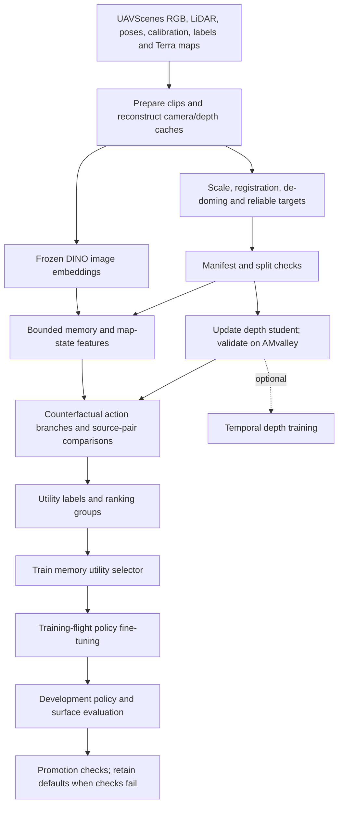

# GeoStreamFusion: implemented pipeline, datasets and architecture files

**Source and artifact inspection: 2 November 2026.**

Repository: `/home/iit-t/GeoStreamFusion_GPU_20261013/GeoStreamFusion_GPU` on `10.23.9.49`.
Bulk storage: `10.23.20.60:/home/vishnu/datasets`.

This describes the code that exists. Implemented stages are not necessarily trained,
validated at scale, or eligible for deployment. No workloads were started to write this file.

## 1. Where the complete architecture lives

There is no single Python module containing the entire system. The pipeline combines
camera estimation, neural depth, selection, geometric fusion and export.

| Open this file | What it contains |
|---|---|
| [run_complete_training.sh](run_complete_training.sh) | Complete ordered training/data/evaluation launcher; this is a shell script |
| [vnext_contract_v3.json](uav_reconstruction/configs/vnext_contract_v3.json) | Main dataset paths, splits, memory limits, model settings, losses and budgets |
| [graph_selector.py](uav_reconstruction/adaptive_uav/graph_selector.py) | `MemoryUtilitySelector`, old `GraphSelector`, frozen visual encoder and inference adapters |
| [depth_student.py](uav_reconstruction/adaptive_uav/depth_student.py) | `DepthStudent`: the compact multiview depth architecture |
| [temporal_depth_student.py](uav_reconstruction/adaptive_uav/temporal_depth_student.py) | Optional temporal depth architecture and warping |
| [final_reconstruct.py](uav_reconstruction/adaptive_uav/final_reconstruct.py) | Main offline reconstruction orchestration |
| [runtime.py](uav_reconstruction/adaptive_uav/runtime.py) | Incremental reconstruction orchestration and optional utility-selector integration |
| [sequential_replay.py](uav_reconstruction/adaptive_uav/sequential_replay.py) | Isolated counterfactual branches and chronological PnP/depth continuation |
| [reconstruct_best.sh](reconstruct_best.sh) | Reconstruction wrapper that checks promotion reports before selecting experimental models |

For the **frame-selection neural architecture**, start at `MemoryUtilitySelector` in
`graph_selector.py` (line 112 at this snapshot). For the **video-to-mesh execution
path**, start at `final_reconstruct.py`. For the **complete training order**, start
at `run_complete_training.sh`.

## 2. Training pipeline at a glance



The frozen DINO encoder is reused, not trained from scratch. Student and selector
training are separate. PyCOLMAP and TSDF fusion do not provide automatic gradients
through the complete video-to-mesh pipeline.

## 3. Exact implemented stages and the data used at each stage

Python filenames below are under `uav_reconstruction/adaptive_uav/`.
The order matches the launcher's `STEPS` array.

| Step | Data used | Implemented operation | Python entry/module | Output or purpose |
|---|---|---|---|---|
| `freeze` | Existing checkpoints, original UAVScenes caches and their supervision/configuration | Verify identities, splits, teacher identity and production defaults | `freeze_reconstruction_baseline.py` | `runs/vnext_baseline_v2/` |
| `clips` | Original 30 UAVScenes cached clips | Link original clips into the combined working set | `prepare_uavscenes_clips.py` (`link`) | `runs/vnext_clips_v1/` and corresponding LiDAR links |
| `newclips` | 71 prepared UAVScenes video clips | Estimate cameras and produce DA3-LARGE depth/reconstruction caches | `final_reconstruct.py`, through `reconstruct_final.sh` | Each new clip's `reconstruction/` |
| `scales` | Available reconstructed UAVScenes cameras and reference trajectories | Estimate visual-to-metric scale | `calibrate_cache_scales.py` | `runs/vnext_dataset_v2/provisional_scale_calibration.json` |
| `geometry` | UAVScenes calibration, RGB/LiDAR metadata and existing measurement assets | Structural/projection/reference checks; reuse an existing gate when present | `validate_reference_geometry.py` | `runs/vnext_dataset_v1/geometry_gate.json` |
| `calibrate` | UAVScenes LiDAR, flight metadata and Terra geometry | Register measured scans against map geometry and qualify alignment | `register_lidar_to_map.py` | `runs/vnext_dataset_v2/calibration.json` and flight reports |
| `dedome` | UAVScenes sparse reconstruction, images and calibration/scale evidence | Correct doming and save corrected pose/intrinsic/anchor overlays | `sfm_dedome.py` | `runs/vnext_dataset_v2/poses/` |
| `targets` | UAVScenes LiDAR, neighbouring scans, Terra maps, semantic labels and corrected poses | Build separated measured/neighbour/map targets and masks; update geometry qualification | `build_calibrated_targets.py` | `runs/vnext_dataset_v2/targets/` and `geometry_gate.json` |
| `records` | UAVScenes frame identities, metadata, targets and gate | Build canonical records and detect split/identity leakage | `trusted_sequences.py` | Frame records, splits and manifest in `runs/vnext_dataset_v2/` |
| `controls` | Original UAVScenes depth caches, measured sidecars and preserved controls | Reproduce the historical matched comparison using the launcher's v1 configuration | `reproduce_controls.py` | Baseline comparison under `runs/vnext_baseline_v2/`; separate from corrected-target scores |
| `student` | Corrected AMtown training clips; eligible HKairport map-only training clips; AMvalley validation | Warm-start v2 and update multiview depth with trust-ordered losses | `train_student_update.py`, `student_dataset.py`, `student_losses.py` | `runs/vnext_student_update_v1/{best.pt,latest.pt,report.json}` |
| `temporal` | Chronological training sequences from the student dataset | Optional temporal branch training around the updated student | `train_student_update.py --temporal`, `temporal_depth_student.py` | `runs/vnext_temporal_student_v1/`; disabled in the current queued launch |
| `embed` | RGB images in available UAVScenes depth caches | Compute frozen DINOv2 ViT-S/14 embeddings | `embedding_cache.py` | `runs/vnext_memory_v1/embeddings/` |
| `memory` | Available cached clips, poses and observable frame/map evidence | Bounded memory/graph shadow replay | `memory_graph.py`; shared features in `selector_features.py` | `runs/vnext_memory_v1/`; this is an infrastructure check, not model training |
| `labels` | Qualified non-calibration AMtown training and AMvalley validation clips, LiDAR reference, student, cached DINO features | Compare isolated SKIP/TRACK_ONLY/NEW_KEYFRAME branches and future continuation | `counterfactual_replay.py` calling `sequential_replay.py` | `runs/vnext_utility_seq_v1/labels*.jsonl`, features and snapshots |
| `sources` | Eligible train/validation clips, measured references, student and DINO features | Measure alternative earlier source-pair depth quality | `source_view_labels.py` | `source_labels.jsonl`, `source_features/`, report in the utility directory |
| `dataset` | Generated action/source supervision | Build within-state rankings, reject censored labels and audit provenance | `build_utility_dataset.py` | `ranking_groups.jsonl`, `quality_audit.json` |
| `selector` | Training ranking groups from AMtown; held-out groups from AMvalley; source labels where available | Supervised utility regression/ranking and auxiliary-head training | `train_utility_selector.py`; architecture in `graph_selector.py` | `runs/vnext_selector_seq_v1/` |
| `finetune` | Eligible non-calibration AMtown training clips and reconstruction rewards | Sample selection policies, compare with the rule and update GRU/utility parameters using policy gradients | `finetune_selector.py`, `selector_policy.py` | `runs/vnext_selector_seq_finetuned_v1/` |
| `evaluate` | AMvalley development clips by default; same reference protocol across policy comparisons | Compare selector, rule and other implemented policies using depth/surface/cost evidence | `evaluate_vnext.py`, `reconstruction_quality.py` | `runs/vnext_video_evaluation_seq_v1/`; offline results cannot grant online deployment |

Important execution details:

- New clip preparation has separate `plan` and `build` commands in
  `prepare_uavscenes_clips.py`. The launcher's `clips` step only links originals;
  it does not download or create arbitrary new datasets.
- Default sequential label generation is capped at **48 decisions globally**.
  Each decision may produce three action branches; this is a bounded pilot.
- `finetune` and `evaluate` use their existing clip-policy path and cached/context
  depth preparation. They are not the same three-branch sequential tracker replay
  used by `labels`. Full online tracker validation remains separate work.
- Geometry qualification is conditional. Current AMtown/AMvalley flights are
  `QUALIFIED`, with real-image human inspection still pending; they are not an
  unconditional sensor-alignment certificate.
- Calibration `_0` clips are explicitly excluded by normal action/source-label,
  fine-tuning and evaluation paths. The student loader does not universally
  exclude `_0` clips, so inspect exact student membership before claiming strict
  calibration-versus-validation separation.
- The queued launch has no `--own-sessions` option. Your seven drone sessions are
  therefore **not automatically included** in its student training.

## 4. Dataset roles, storage and current readiness

| Dataset/source | Actual role in the implemented default training path | Storage/readiness |
|---|---|---|
| UAVScenes AMtown01–03 | Student training and eligible selector/reward training | Prepared subsets local; bulk assets on storage server |
| UAVScenes HKairport01–03 | Eligible map-only student training; failed LiDAR alignment excludes normal selector rewards | Map-only exception depends on the flight gate; not all failed data is accepted |
| UAVScenes AMvalley01–03 | Depth validation, selector validation and development policy evaluation | This is development/model-selection data, not a sealed final test |
| UAVScenes HKisland01–03 | Diagnostic data | Repeatedly inspected; not a fresh final test and not a selector training split |
| Raw UAVScenes LiDAR | Measured supervision/reference when reliability and registration permit | Kept separate from teacher and Terra targets |
| UAVScenes Terra maps | Registration aid and dense map-depth targets | Photogrammetric/image-derived geometry, not independent sensor truth |
| UAVScenes semantic labels | Vehicle/water and other configured rejection masks | Existing prepared masks under `runs/vnext_dataset_v2/semantic_labels/` |
| Cached DA3-LARGE predictions | Frozen teacher/control and lower-trust depth supervision | Derived from RGB; never relabelled as measured LiDAR |
| Your seven drone sessions | Optional self-supervised student examples via explicit `--own-sessions` cache paths | Available locally; not included automatically and no independent geometry implied |
| MARS-LVIG raw bags | Optional future timing/deskew investigation | Not needed or read by the default launcher; previous audit found incomplete bags |
| Dronescapes, MatrixCity, Mid-Air, UseGeo, MUN-FRL, NTU VIRAL | Auxiliary or future external experiments | Not automatically consumed by this training launcher |
| New untouched locations with independent geometry | Required for an independent final-system claim | No sealed final-test set is currently configured |
| Current Google Drive `data` import | Unclassified incoming assets | Destination is `/home/vishnu/datasets/drive_imports/data`; download does not add it to training. Inventory/provenance/splits/adapters must be established first |

Current local file inventory from this inspection:

- **101 prepared clip directories:** 30 original-cache links plus 71 new clips.
- **30 clips currently contain depth-cache files.** A prepared video is not yet
  a completed reconstruction/training cache.
- **1,330 target NPZ files** currently exist in the configured corrected-target
  tree. This file count is not the number of independent training scenes or the
  final eligible training-example count.
- Gate: **6 QUALIFIED, 6 FAILED, 0 VERIFIED, 0 UNRESOLVED flights**.
- Previous remote audit: 15 UAVScenes archives, approximately **105.103 GB**,
  passed expected-size and bounded archive/extraction checks. This document does
  not repeat that audit or assert that the current Drive import is finished.

Main configured local paths:

```text
runs/vnext_clips_v1/                       original links + new prepared clips
runs/vnext_clips_v1_lidar/                 matched LiDAR/flight metadata
runs/vnext_dataset_v2/targets/             corrected depth targets
runs/vnext_dataset_v2/poses/               corrected poses, K and anchors
runs/vnext_dataset_v2/semantic_labels/     prepared label masks
runs/vnext_dataset_v1/terra/               local Terra working geometry
runs/vnext_memory_v1/embeddings/           DINO cache produced by embed
```

## 5. Implemented frame-selection architecture

Primary file: [graph_selector.py](uav_reconstruction/adaptive_uav/graph_selector.py),
class `MemoryUtilitySelector`.

```text
Candidate RGB -> frozen DINOv2 ViT-S/14 -> visual vector [384]
Observable candidate/map/budget features                  [17]
    concatenate -> Linear 401->128 -> LayerNorm -> GELU
    + learned question embedding (7 questions)

Up to 16 retrieved historical memory entries:
    per entry: DINO [384] + geometry/state [11]
    -> Linear 395->128 -> LayerNorm -> GELU

Candidate query token + valid memory tokens
    -> 2 Transformer encoder layers
       4 attention heads, hidden 128, feed-forward 256, dropout 0.1
    -> candidate token -> GRU 128

Output heads:
    action:       4 logits (NEW_KEYFRAME / TRACK_ONLY / SKIP / RELOCALIZE)
    utility:      coverage / surface / connectivity / total utility
    cost:         1 value
    uncertainty:  1 log-variance value
    source-pair:  symmetric MLP score for memory-token pairs, when requested
```

The seven question embeddings distinguish fidelity/intervention pairs; they are
not seven actions. Their definitions live in `utility_contracts.py`.

The memory defaults include 64 active keyframes, recent/historical retrieval
limits of 4/12, and 16 candidate memory slots. The Transformer also receives the
candidate query token. Retrieval proposes evidence; geometric verification and
bridge safeguards remain necessary.

The presence of a GRU does not establish trained long-term recurrent carry.
Current independent-decision supervised training and `UtilityRuntime` reset hidden
state between decisions. Runtime utility selection primarily defers optional
mapping frames accepted by the rule; it does not deploy unrestricted four-action
control solely from the action logits. RELOCALIZE has no claim of verified
supervision in the current sample.

Supporting files:

| Responsibility | File |
|---|---|
| Frozen image descriptor caching | `embedding_cache.py` |
| Bounded keyframe graph and geometric retrieval | `memory_graph.py` |
| Map coverage, features and private state forks | `selector_features.py` |
| Label schemas, features, questions and budgets | `utility_contracts.py` |
| Counterfactual action branches | `sequential_replay.py` |
| Ranking, utility, cost, uncertainty, action and pair losses | `train_utility_selector.py` |
| Clip policy execution and sampled selection | `selector_policy.py` |
| Online proposal/commit and hard geometric policy | `keyframe_policy.py`, `runtime.py` |

The older `GraphSelector` in the same file is a separate 384+8 -> 96 -> GRU96
architecture. Its checkpoints are not interchangeable with `MemoryUtilitySelector`.
The legacy `OverlapAttention` unused-attention issue is not repaired by these new
selector classes and must not be described as a validated trained attention model.

## 6. Implemented depth architecture

Primary file: [depth_student.py](uav_reconstruction/adaptive_uav/depth_student.py),
class `DepthStudent` (128,515 parameters in its existing 48-channel/24-plane form).

```text
Reference RGB + up to two posed source RGB views, each 192x256
    -> shared CNN -> 48-channel image features
    -> pose/K projection over 24 depth planes
    -> geometric cost volume -> 3D CNN -> expected depth
    -> refinement CNN -> depth + confidence
```

Poses are world-to-camera at the network interface. Depth is camera-axis Z.
Depth and translations use sparse RGB/SfM-anchor normalization; normalized depth
hypotheses span approximately 0.25–4.0. Normalization/anchor fitting is implemented
in `student_inference.py` and the training/data adapters.

`train_student_update.py` warm-starts from the protected v2 checkpoint in a new
directory. `student_losses.py` implements masked measured, neighbour, map,
anchor, teacher, confidence, photometric, smoothness and conditional temporal
consistency/visibility terms. A term only has evidence when its required targets
or temporal inputs exist. Terra targets and teachers retain their provenance.

Optional temporal depth is in `temporal_depth_student.py`; it is disabled in the
queued launch. The student remains an experiment, and DA3 remains the supported
depth control/fallback until matched validation and deployment requirements pass.

## 7. Reconstruction/inference pipeline

Input is a session containing video plus any available calibrated metadata.
Training references such as LiDAR are not required inputs for ordinary video
reconstruction. Reliable absolute metric scale still needs an appropriate source.

```text
Video/session
 -> session metadata and frame candidates
 -> camera tracking/estimation and geometric selection
 -> undistorted views and source contexts
 -> semantic filtering when enabled
 -> DA3 or explicitly eligible student depth
 -> depth confidence/geometry checks
 -> geometric fusion / TSDF surface reconstruction
 -> colored point cloud, mesh, PLY/GLB, viewer and reports
```

| Responsibility | Implemented files under `uav_reconstruction/adaptive_uav/` |
|---|---|
| Session input | `session_inputs.py` |
| Offline entry and camera/reconstruction orchestration | `final_reconstruct.py`, `combined_reconstruct.py` |
| Dense source contexts, depth and fusion | `multiview_dense.py`, `hybrid_dense.py` |
| Depth dispatch / incremental depth | `depth_backend.py` |
| Semantics | `semantic_scene.py` |
| Incremental tracking and runtime | `runtime.py`, `pose_backend.py`, `pose_dpvo.py` |
| Incremental fusion and pose-aware submaps | `submaps.py` |
| Viewer/export integration | `mesh_viewer.py` and existing dense/export utilities |
| Experimental checkpoint activation | `promotion_gate.py` plus `reconstruct_best.sh` |

`reconstruct_best.sh` defaults to DA3-LARGE when the student fails its report/hash
gate. Its offline route enables lens-distortion refinement, whose real-video
validation remains incomplete. Its streaming route retains the rule selector
unless a matching full-video, causal promotion report passes. The offline
`evaluate_vnext.py` path deliberately cannot produce that deployment pass.

## 8. What has actually run

- Existing and new correctness tests: **112 passed** on 2 November.
- A bounded real-cache replay: three branches completed, PnP registration succeeded.
- CPU sample selector training: **18 labels**, 12 train / 6 validation, five epochs,
  20 optimizer steps, zero skipped updates. It used `thumbnail384`, **not DINO**.
  AMvalley validation ranking was 0/2; there is no demonstrated validation gain.
  See [sample summary](runs/sample_selector_cpu_20261102_0S4L3W/summary.json).
- The full queued launcher passed `freeze` and `clips`; at inspection it was
  waiting at `newclips` for another user's GPU workload to finish.
- Full-scale training, full DINO-stage execution for this run, and independent
  causal full-video validation are not completed by these checks.
- Full-clip SfM anchors/poses and reference alignment still qualify the offline
  labels. Past-only source images alone do not make them causal online evidence.

## 9. Current run and where to read progress

The existing launcher was started with `--threads 2 --wait-for-gpu` at low CPU/I/O
priority. No new training process is started by this document. Do not launch a
second full pipeline while it is active.

```bash
tail -f runs/training_launch_20261102_132419/launcher.log
```

Run status: [status.json](runs/training_launch_20261102_132419/status.json).
Per-stage logs and signed completion markers: `runs/vnext_logs/`.
Stage signatures/resume checks: `stage_cache.py`.

The GPU check waits for zero compute processes before a GPU stage; it is not a
GPU reservation system and does not prevent another user starting a later job.
CPU library thread limits are set, but some stages explicitly request multiple
workers, so `--threads 2` is not a strict process-wide two-core resource quota.
No process is stopped or signalled to make room.

Use this file together with [VNEXT_RUNBOOK.md](VNEXT_RUNBOOK.md) for execution
details and [GEOSTREAMFUSION_COMPLETE_TRAINING_PLAN.md](GEOSTREAMFUSION_COMPLETE_TRAINING_PLAN.md)
for the broader scientific gates. Older architecture documents are dated historical
snapshots and can describe work as proposed that is now implemented here.
